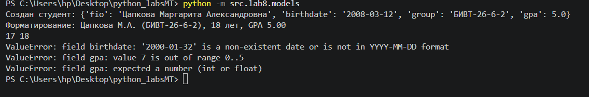
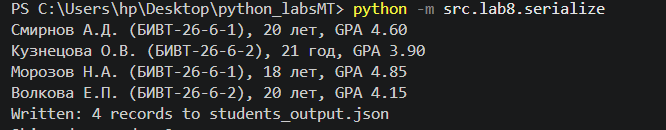
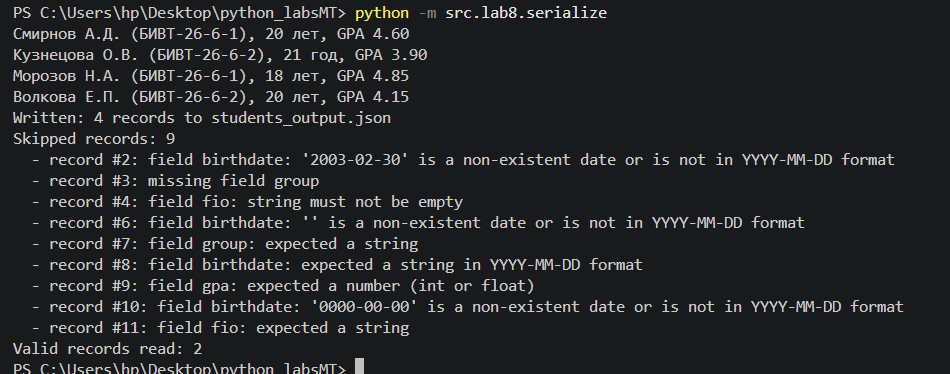

# ЛР8 - Модель данных без классов: запись `Student` как словарь, валидация и сериализация

## Модель данных Student

```python
{
    "fio": "Андреев Андрей Андреевич",
    "birthdate": "2008-03-19",
    "group": "БИВТ-26-6-2",
    "gpa": 4.7
}
```

Обязательные ключи
STUDENT_FIELDS = ("fio", "birthdate", "group", "gpa")

### Создание записи

make_student(fio, birthdate, group, gpa) создаёт новую запись,
удаляет лишние пробелы в ФИО и названии группы, средний балл приводится к
float и начинается валидация.

### Задание А

### models.py
```python
from datetime import date

STUDENT_FIELDS = ("fio", "birthdate", "group", "gpa")


def check_text(value, name):
    """fio and group: must be a string, non-empty after strip(). Returns the stripped string."""
    if not isinstance(value, str):
        raise ValueError(f"field {name}: expected a string")
    value = value.strip()
    if value == "":
        raise ValueError(f"field {name}: string must not be empty")
    return value


def check_birthdate(value):
    """birthdate: string in YYYY-MM-DD format, a real date, not in the future."""
    if not isinstance(value, str):
        raise ValueError("field birthdate: expected a string in YYYY-MM-DD format")
    try:
        d = date.fromisoformat(value)
    except ValueError:
        raise ValueError(f"field birthdate: '{value}' is a non-existent date or is not in YYYY-MM-DD format")
    if d > date.today():
        raise ValueError(f"field birthdate: date '{value}' is in the future")
    return value


def check_gpa(value):
    """gpa: int or float, 0 <= gpa <= 5. Returns a float."""
    if not isinstance(value, (int, float)):
        raise ValueError("field gpa: expected a number (int or float)")
    if not (0 <= value <= 5):
        raise ValueError(f"field gpa: value {value} is out of range 0..5")
    return float(value)


def make_student(fio, birthdate, group, gpa):
    """Builds a student record, validating each field.

    make_student("Иванов Иван Иванович", "2007-05-14", "БИВТ-26-6-1", 4.3)
    """
    return {
        "fio": check_text(fio, "fio"),
        "birthdate": check_birthdate(birthdate),
        "group": check_text(group, "group"),
        "gpa": check_gpa(gpa),
    }


def validate_student(rec):
    """Validates a complete record: key set and values. Raises ValueError on error."""
    if not isinstance(rec, dict):
        raise ValueError("Record must be a dictionary")
    if set(rec) != set(STUDENT_FIELDS):
        missing = set(STUDENT_FIELDS) - set(rec)
        extra = set(rec) - set(STUDENT_FIELDS)
        raise ValueError(f"invalid key set: missing {sorted(missing)}, extra {sorted(extra)}")
    check_text(rec["fio"], "fio")
    check_birthdate(rec["birthdate"])
    check_text(rec["group"], "group")
    check_gpa(rec["gpa"])


def student_age(rec, today=None):
    """Full years of age on the given date (today by default)."""
    b = date.fromisoformat(rec["birthdate"])
    today = today or date.today()
    age = today.year - b.year
    if (today.month, today.day) < (b.month, b.day): 
        age -= 1
    return age


def years_word(n):
    """Correct word form: 1 год, 2 года, 5 лет."""
    if 11 <= n % 100 <= 14:
        return "лет"
    if n % 10 == 1:
        return "год"
    if 2 <= n % 10 <= 4:
        return "года"
    return "лет"


def format_student(rec):
    """Иванов И.И. (БИВТ-26-6-1), 19 лет, GPA 4.30"""
    parts = rec["fio"].split()
    initials = "".join(p[0].upper() + "." for p in parts[1:3])
    name = parts[0] + (" " + initials if initials else "")
    age = student_age(rec)
    return f"{name} ({rec['group']}), {age} {years_word(age)}, GPA {rec['gpa']:.2f}"


def student_to_dict(rec):
    """Copy of the record (not the same dictionary) for serialization."""
    validate_student(rec)
    return {key: rec[key] for key in STUDENT_FIELDS}


def student_from_dict(d):
    """Deserialization: takes exactly the required keys, make gpa to float, validates."""
    if not isinstance(d, dict):
        raise ValueError("Record must be an object (dictionary)")
     for key in STUDENT_FIELDS:
        if key not in d:
            raise ValueError(f"missing field {key}")
    return make_student(d["fio"], d["birthdate"], d["group"], d["gpa"])

```

Проверяется, что:
1. Фио и группа являются непустыми строками 
2. Дата рождения записана в формате YYYY-MM-DD. Дата существует и не из будущего.
3. Средний балл лежит в пределе 0..5 и тип приводится к float


1. Были написаны подфункции для многоразового применения `check_text`, `check_birthdate`, `check_gpa`, проверяющие по одному формату и возвращающие ValueError с указанием в каком конкретно поле ошибка и какая. 
2. `make_student`: проводит проверку всех полей и собирает словарь. Дата проверяется с помощью date.fromisoformat, так что несуществующие даты отклоняются. Булевые значения в отметках не допускается.
3. `validate_student` проверяет готовый словарь. `set(rec) == set(STUDENT_FIELDS)` проверяет что все ключе есть и нет лишних, а после проверяются сами значения (при ошибке в сообщении выводится, каких ключей нет и какие лишние).
4. `student_age`: считает сколько лет человеку на конкретную дату.
5. `format_student`: формирует строку вида `Андреев А.А., (БИВТ-26-6-2), 18 лет, GPA 4.70`. Уже сталкивались с похожим в ЛР1.
6. `student_to_dict`: проверяет запись и возвращает её копию (новый словарь).
7. `student_from_dict`: берёт из словаря нужные ключи, при отсутствии ключа выдаёт `ValueError`.

### Задание В

### `serialize.py`

``` python 
import json
from pathlib import Path

from src.lab8.models import student_to_dict, student_from_dict, format_student


def students_to_json(students, path):
    """Saves a list of records to JSON. """
    data = [student_to_dict(s) for s in students]
    Path(path).parent.mkdir(parents=True, exist_ok=True)
    with open(path, "w", encoding="utf-8") as f:
        json.dump(data, f, ensure_ascii=False, indent=2)


def students_from_json(path):
    """Reads a JSON array and returns a list of valid records.

    Policy: broken records are skipped; at the end it prints
    how many were skipped and why.
    """
    if not Path(path).is_file():
        raise FileNotFoundError(f"File not found: {path}")
    with open(path, encoding="utf-8") as f:
        data = json.load(f)
    if not isinstance(data, list):
        raise ValueError("Expected a JSON array of records")

    students = []
    errors = []
    for number, item in enumerate(data, start=1):
        try:
            students.append(student_from_dict(item))
        except ValueError as e:
            errors.append(f"record #{number}: {e}")

    if errors:
        print(f"Skipped records: {len(errors)}")
        for message in errors:
            print(f"  - {message}")
    return students

```

1. `students_to_json`: у всех записей появляется копия с помощью `student_to_dict` (+ данные проверяются), и весь список записывается как JSON. Папка для файла создаётся при необходимости.
2. `students_from_json`: читает JSON-файл, все записи прогоняет через `student_from_dict`. Также обрабатываются случаи когда файла нет или подан не массив.
3. Для работы с битыми записями выбрана модель `skip`. Битая запись пропускается, остальные читаются дальше, а в конце в терминал выводится, сколько записей пропущенои c причиной. С помощью этого метода удаётся загрузить все хорошие записи из файла, а проблемные моменты реализовать как отчёт.

## Проверка

### Работа models.py
```python 

def main():
    s = make_student("Цапкова Маргарита Александровна", "2008-03-12", "БИВТ-26-6-2", 5)
    print("Создан студент:", s)
    
    print("Форматирование:", format_student(s))

    print(student_age(s, date(2026, 3, 11)), student_age(s, date(2026, 3, 12)))

    for args in (("Васильев Василий Васильевич", "2000-01-32", "БИВТ-26-6-1", 4.0),
                 ("Андреев Андрей Андреевич", "2005-03-19", "БИВТ-26-6-1", 7),
                 ("Иванов Иван Иванович","2008-05-01","БИВТ-26-6-2", "4" )):
        try:
            make_student(*args)
        except ValueError as e:
            print("ValueError:", e)

if __name__ == "__main__":
    main()
```
Вывод в консоль:


### Работа serialize.py

``` python 
def main():
   
    students = students_from_json("data/lab8/students_input.json")
    for s in students:
        print(format_student(s))
    students_to_json(students, "data/lab8/students_output.json")
    print("Written:", len(students), "records to students_output.json")


    good = students_from_json("data/lab8/students_bad.json")
    print("Valid records read:", len(good))


if __name__ == "__main__":
    main()

```
Результаты 

До преобразования (data/lab8/good_input.json):
```json
[
  {"fio": "Смирнов Алексей Дмитриевич", "birthdate": "2006-03-17", "group": "БИВТ-26-6-1", "gpa": 4.6},
  {"fio": "Кузнецова Ольга Викторовна", "birthdate": "2005-08-09", "group": "БИВТ-26-6-2", "gpa": 3.9},
  {"fio": "Морозов Никита Андреевич", "birthdate": "2007-12-01", "group": "БИВТ-26-6-1", "gpa": 4.85},
  {"fio": "  Волкова Екатерина Павловна ", "birthdate": "2006-06-23", "group": "БИВТ-26-6-2", "gpa": 4.15}
]
```

Вывод в консоль:



После преобразования data/lab08/good_output.json:
```json
[
  {
    "fio": "Смирнов Алексей Дмитриевич",
    "birthdate": "2006-03-17",
    "group": "БИВТ-26-6-1",
    "gpa": 4.6
  },
  {
    "fio": "Кузнецова Ольга Викторовна",
    "birthdate": "2005-08-09",
    "group": "БИВТ-26-6-2",
    "gpa": 3.9
  },
  {
    "fio": "Морозов Никита Андреевич",
    "birthdate": "2007-12-01",
    "group": "БИВТ-26-6-1",
    "gpa": 4.85
  },
  {
    "fio": "Волкова Екатерина Павловна",
    "birthdate": "2006-06-23",
    "group": "БИВТ-26-6-2",
    "gpa": 4.15
  }
]
```


Результат обработки файла с битыми записями

Входной файл: data/lab8/bad_input.json
```json

  [
  {"fio": "Фёдоров Артём Игоревич", "birthdate": "2007-03-21", "group": "БИВТ-26-6-4", "gpa": 4.5, "abc" : "2006-01-01"},
  {"fio": "Никитин Павел Олегович", "birthdate": "2003-02-30", "group": "БИВТ-26-6-4", "gpa": 3.8},
  {"fio": "Лебедев Максим Сергеевич", "birthdate": "05/11/2006", "gpa": 3.2},
  {"fio": "   ", "birthdate": "2006-04-12", "group": "БИВТ-26-6-5", "gpa": 3.0},
  {"fio": "Тимофеева Анна Викторовна", "birthdate": "2006-10-08", "group": "БИВТ-26-6-6", "gpa": 4.9},
  {"fio": "Михайлова Дарья Алексеевна", "birthdate": "", "group": "", "gpa": 4.0},
  {"fio": "Петров Пётр Петрович", "birthdate": "2006-09-30", "group": 261, "gpa": 4.2},
  {"fio": "Николаева Ольга Петровна", "birthdate": null, "group": "БИВТ-26-6-10", "gpa": 4.3},
  {"fio": "Орлов Михаил Андреевич", "birthdate": "2006-03-03", "group": "БИВТ-26-6-11", "gpa": null},
  {"fio": "Васильева Юлия Игоревна", "birthdate": "0000-00-00", "group": "БИВТ-26-6-11", "gpa": "отлично"},
  {"fio": 12345, "birthdate": "2006-08-08", "group": "БИВТ-26-6-12", "gpa": 4.0}
]

Вывод в консоль:

