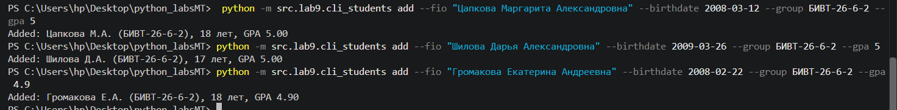
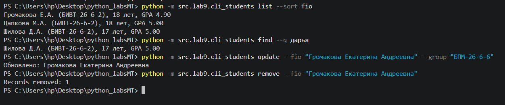
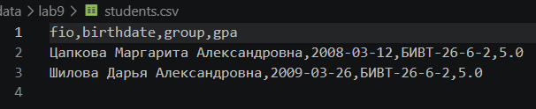

# ЛР9 — «База данных» на CSV: CRUD-функции над `students.csv` и CLI
## Задание А - `group.py`
### `ensure_storage(path)`
``` python
def ensure_storage(path):
    """Creates folders and a file with a header row if the file does not exist yet."""
    path = Path(path)
    if not path.exists():
        save_students(path, [])
```
Функция проверяет существует файл или нет, если нет, то создает файл с заголовком.

### `_gpa_to_float(value)`
``` python 
def _gpa_to_float(value):
    """Converts gpa from a CSV string to a float in one place."""
    if value is None or value.strip() == "":
        raise ValueError("gpa field: empty value")
    try:
        return float(value)
    except ValueError:
        raise ValueError(f"gpa field: '{value}' is not a number")
```
Вспомогательная функция для удобной проверки данных у gpa и конвертации(если возможно) во float

### `load_students(path)`
``` python 
def load_students(path):
    """Reads all records from the CSV file. Each row is processed with student_from_dict."""
    path = Path(path)
    if not path.is_file():
        raise FileNotFoundError(f"File not found: {path}")

    students = []
    with open(path, encoding="utf-8", newline="") as f:
        reader = csv.DictReader(f)
        if reader.fieldnames is None:
            raise ValueError("CSV file has no header row")
        if set(reader.fieldnames) != set(HEADER):
            raise ValueError(
                f"invalid CSV header: {reader.fieldnames}, expected  {list(HEADER)}"
            )
        for number, row in enumerate(reader, start=2):  # row 1 is the header
            if None in row:
                raise ValueError(f"row {number}: extra columns")
            try:
                row["gpa"] = _gpa_to_float(row["gpa"])
                students.append(student_from_dict(row))
            except ValueError as e:
                raise ValueError(f"row {number}: {e}")
    return students
```
Читает файл, проверяет есть ли в нём лишние колонки или неверный заголовок. (возвращает список словарей)

### `save_students(path, students)`
```python
def save_students(path, students):
    """Overwrites the entire file."""
    path = Path(path)
    path.parent.mkdir(parents=True, exist_ok=True)
    with path.open("w", encoding="utf-8", newline="") as f:
        writer = csv.DictWriter(f, fieldnames=HEADER)
        writer.writeheader()
        writer.writerows(students)
```
Перезаписывает весь CSV-файл

### `add_student(path, student)`
``` python 
def add_student(path, student):
    """Validates the record and adds it to the end of the file."""
    validate_student(student)
    students = load_students(path)
    students.append(student_to_dict(student))
    save_students(path, students)
```
Валидирует запись студента и добавляет ее в конец. Потом сохраняет весь файл.

### `list_students(path, sort_by=None)`
``` python 
def list_students(path, sort_by=None):
    """Returns all students; sort_by can be None, 'fio', or 'gpa' (low to high)."""
    students = load_students(path)
    if sort_by is None:
        return students
    if sort_by not in ("fio", "gpa"):
        raise ValueError(f"unknown sort field: {sort_by}")
    return sorted(students, key=lambda s: s[sort_by])

```
Сортирует список студентов по `fio` или `gpa`, или вообще не сортирует.

### `find_students(path, substr)`
``` python 
def find_students(path, substr):
    """Returns records where substr is in the full name (Ignoring case)."""
    students = load_students(path)
    needle = substr.casefold()
    return [s for s in students if needle in s["fio"].casefold()]
```
Возвращает студентов, у которых `substr` входит в `"fio"`. Регистр не учитывается.

### `remove_student(path, fio)`
``` python
def remove_student(path, fio):
    """Deletes all records with the given full name and returns the count of removed records."""
    students = load_students(path)
    kept = [s for s in students if s["fio"] != fio]
    removed = len(students) - len(kept)
    if removed > 0:
        save_students(path, kept)
    return removed
```
Удаляет все записи, содержащие фио, указанное пользователем, возвращает количество удаленных записей.

### `update_student(path, fio, **fields)`
``` python
def update_student(path, fio, **fields):
    """Updates fields of the first record with the given full name. Returns True if found."""
    for key in fields:
        if key not in HEADER:
            raise KeyError(f"unknown sort field: {key}")
    students = load_students(path)
    for i in range(len(students)):
        if students[i]["fio"] == fio:
            new_rec = dict(students[i])
            new_rec.update(fields)
            students[i] = student_from_dict(new_rec)  # validate the result
            save_students(path, students)
            return True
    return False
```
Функция обновляет запись студента с заданным ФИО по указанным параметрам, валидирует результат (возвращает True или False)

## Задание В - `cli_students.py`
``` python
import argparse
import sys

from src.lab8.models import make_student, format_student
from src.lab9.group import ensure_storage, add_student, list_students, find_students, remove_student, update_student

DEFAULT_DB = "data/lab9/students.csv"


def fail(message):
    """Prints an error to stderr and exits the program with code 1."""
    print(f"Error: {message}", file=sys.stderr)
    raise SystemExit(1)


def main():
    # общий параметр --db для всех подкоманд
    common = argparse.ArgumentParser(add_help=False)
    common.add_argument("--db", default=DEFAULT_DB, help=f"path to CSV storage (default:{DEFAULT_DB})")

    parser = argparse.ArgumentParser(description="CLI for student storage (CSV)")
    sub = parser.add_subparsers(dest="cmd")

    p = sub.add_parser("add", parents=[common], help="Add a student")
    p.add_argument("--fio", required=True)
    p.add_argument("--birthdate", required=True, help="YYYY-MM-DD")
    p.add_argument("--group", required=True)
    p.add_argument("--gpa", type=float, required=True, help="from 0 to 5")

    p = sub.add_parser("list", parents=[common], help="List all students")
    p.add_argument("--sort", choices=["fio", "gpa"], help="sort order")

    p = sub.add_parser("find", parents=[common], help="Search by substring in full name")
    p.add_argument("--q", required=True, help="substring (Ignoring case)")

    p = sub.add_parser("remove", parents=[common], help="Remove a student by full name")
    p.add_argument("--fio", required=True)

    p = sub.add_parser("update", parents=[common], help="Update student fields")
    p.add_argument("--fio", required=True)
    p.add_argument("--gpa", type=float)
    p.add_argument("--group")
    p.add_argument("--birthdate")

    args = parser.parse_args()
    if args.cmd is None:
        parser.error("Please specify a subcommand: add, list, find, remove, or update")

    try:
        ensure_storage(args.db)

        if args.cmd == "add":
            student = make_student(args.fio, args.birthdate, args.group, args.gpa)
            add_student(args.db, student)
            print(f"Added: {format_student(student)}")

        elif args.cmd == "list":
            students = list_students(args.db, args.sort)
            if not students:
                print("No students found")
            for s in students:
                print(format_student(s))

        elif args.cmd == "find":
            students = find_students(args.db, args.q)
            if not students:
                print("Nothing found")
            for s in students:
                print(format_student(s))

        elif args.cmd == "remove":
            print(f"Records removed: {remove_student(args.db, args.fio)}")

        elif args.cmd == "update":
            fields = {}
            if args.gpa is not None:
                fields["gpa"] = args.gpa
            if args.group is not None:
                fields["group"] = args.group
            if args.birthdate is not None:
                fields["birthdate"] = args.birthdate
            if not fields:
                parser.error("specify at least one field to update: --gpa, --group, or --birthdate")
            if update_student(args.db, args.fio, **fields):
                print(f"Обновлено: {args.fio}")
            else:
                fail(f"студент не найден: {args.fio}")

    except KeyError as e:
        fail(e.args[0])
    except (ValueError, FileNotFoundError) as e:
        fail(e)


if __name__ == "__main__":
    main()
```
1. Параметр --db задан один раз в родительском парсере common (add_help=False), чтоб не было конфликта со справкой основного парсера. Пармаетр подлючен ко всем подкомандам через parents=[common]. По умолчанию установлено data/lab9/students.csv.
2. Подкоманды: add, list, find, remove, update создаются через add_subparsers(dest="cmd"). У add все поля обязательные, у update обязателен --fio, остальные поля необязательные. --sort ограничен choices=["fio", "gpa"].
3. Функция fail печатает Ошибка: ... в stderr и завершает программу с кодом 1. Программа запоминает ValueError (невалидные данные), KeyError (неизвестное поле) и FileNotFoundError. Ошибки аргументов (update без полей, неверный --sort) обрабатывает argparse, код возврата 2.


## Работа парсера

### Блок создания csv и добавления студентов 


### Блок взаимодействия с созданным набором записей


### Что осталось в csv после удаления записи стедента 



## Обработка ошибок

